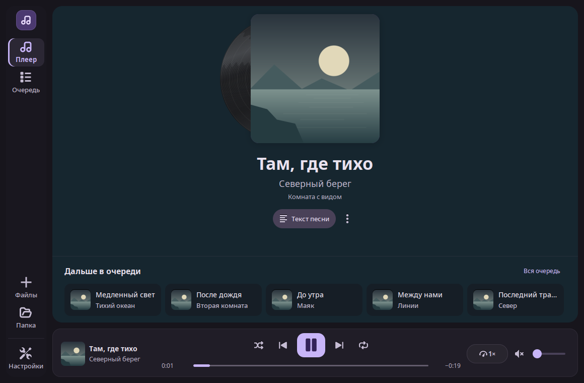

<h1 align="center">
  
</h1>

Veyra — музыкальный плеер для Linux на Rust, GTK 3 и mpv. можно слушать локальную музыку, собирать очередь, смотреть обложки и тексты песен. есть поиск по библиотеке, перемешивание, повтор, настройка скорости и громкости.

если текста песни нет локально, плеер ищет его в LRCLIB. обложки можно искать по CSV Яндекс Музыки или отключить этот поиск в настройках. с SoundCloud можно вручную скачать оригинал трека, если автор разрешил скачивание.



*Экран [рабочей версии](https://github.com/68RTF/veyra/tree/codex/player-ui-refactor), с демонстрационной музыкой и обложкой.*

## установка

готовые пакеты лежат в [релизах](https://github.com/68RTF/veyra/releases). выбери пакет под свою систему:

- Arch Linux (x86_64): `.pkg.tar.zst`, установка через `sudo pacman -U ./veyra-0.7.0-1-x86_64.pkg.tar.zst`.
- Ubuntu 24.04 (amd64): `veyra_0.7.0_ubuntu24.04_amd64.deb`.
- Debian 13 (amd64): `veyra_0.7.0_debian13_amd64.deb`.

для Ubuntu и Debian команда установки одинаковая: `sudo apt install ./ИМЯ_СКАЧАННОГО_ФАЙЛА.deb`.

для сборки из исходников понадобятся Rust/Cargo, заголовки GTK 3 и `pkg-config`. для запуска нужны GTK 3, mpv, ffmpeg/ffprobe и curl. `secret-tool` (libsecret) нужен только для хранения токена SoundCloud в связке ключей.

```sh
cargo build --release --locked --bins
install -Dm755 target/release/veyra ~/.local/bin/veyra
install -Dm755 target/release/ym-export ~/.local/bin/ym-export
install -Dm644 veyra.desktop ~/.local/share/applications/veyra.desktop
install -Dm644 assets/veyra.svg ~/.local/share/icons/hicolor/scalable/apps/veyra.svg
```

для создания пакета Arch из текущих исходников: `bash scripts/build-arch.sh`. для Ubuntu 24.04 или Debian 13: `bash scripts/build-deb.sh ubuntu24.04` или `bash scripts/build-deb.sh debian13` на соответствующей системе. готовые пакеты будут в `dist/`.

## использование

добавь файлы или папку через боковую панель. чтобы включить трек из очереди, дважды нажми на него или нажми Enter. порядок можно менять перетаскиванием и через меню.

плеер читает локальные `.lrc` и `.txt`, встроенные тексты и ищет недостающие в LRCLIB. результаты поиска сохраняются в кэше. обложки берутся из файла или папки. для поиска обложек Яндекс Музыки нужно подключить CSV. отключить поиск можно в настройках.

с SoundCloud скачиваются только треки, для которых разрешена загрузка оригинала. токен хранится через `secret-tool`, а если связка ключей недоступна — только до закрытия плеера. при отмене загрузки временные файлы удаляются. индекс скачиваний хранится в `~/.local/share/own-player/soundcloud-downloads.json` с правами 0600. старый каталог данных оставлен, чтобы после переименования не потерялись настройки и очередь. при пакетной загрузке список пропущенных треков сохраняется в выбранную папку.

экспорт метаданных плейлиста Яндекс Музыки без аудио:

```sh
ym-export 'PLAYLIST_URL' -o playlist.csv
```

## проверка

```sh
cargo fmt --check
cargo test --locked
cargo clippy --locked --all-targets -- -D warnings
scripts/check-ui.sh
cargo build --release --locked --bins
```

UI-тест требует Xvfb, ImageMagick, ffmpeg и mpv. тест работает с временными данными и не обращается к внешним сервисам. live-тесты SoundCloud, LRCLIB и Яндекс Музыки по умолчанию не запускаются. GitHub Actions собирает отдельные пакеты для трёх дистрибутивов и прикладывает их к релизу для тега `v*`.

у проекта пока нет лицензии на повторное использование кода.
